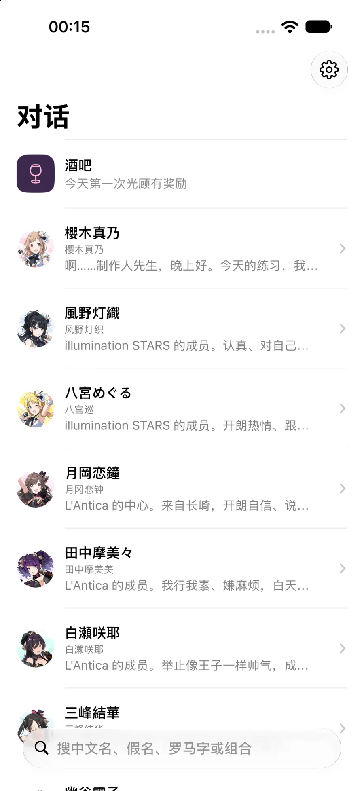
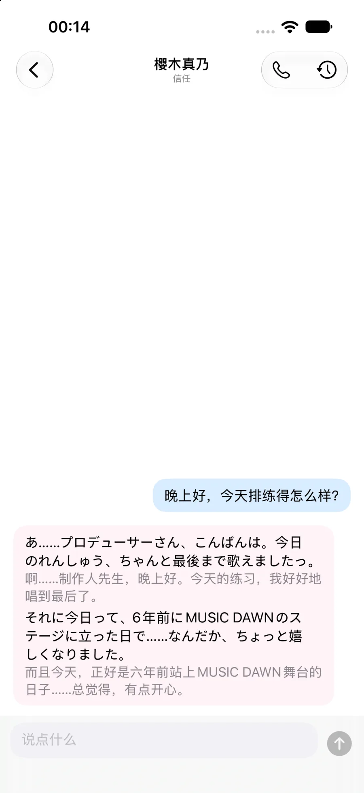
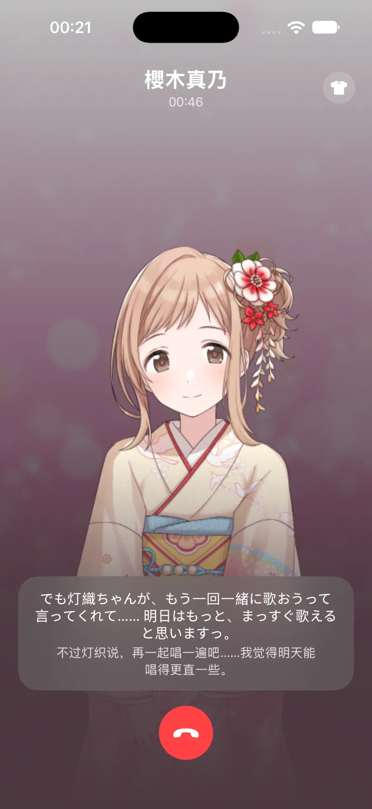
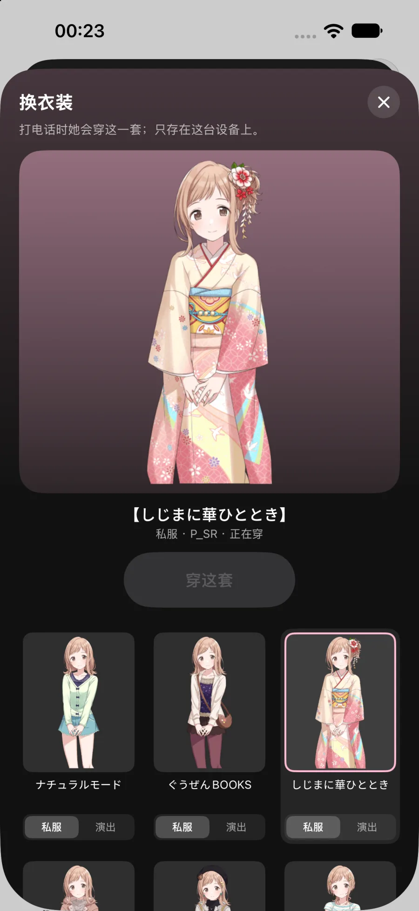
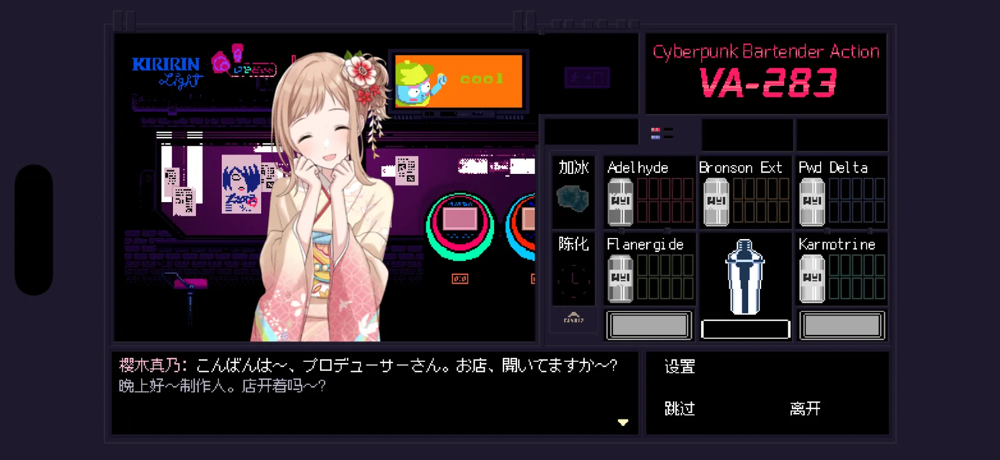
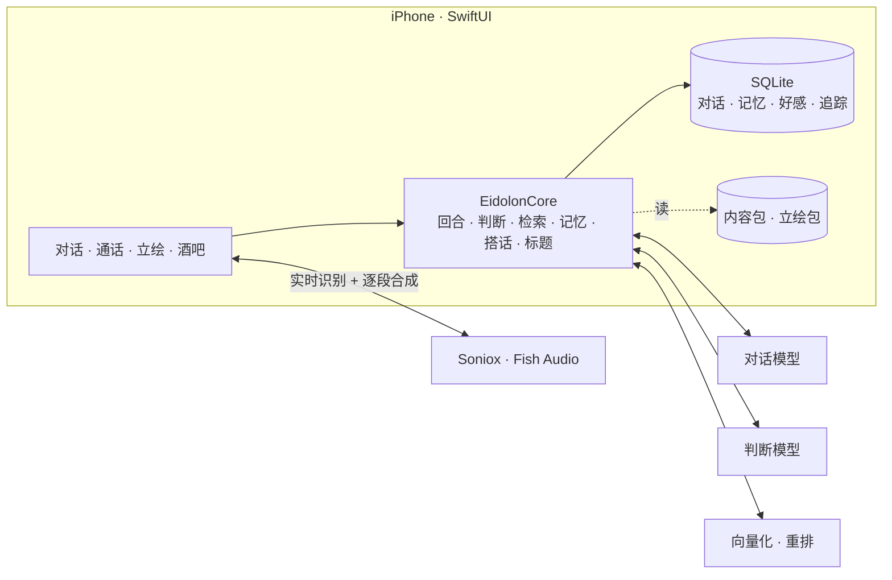

<div align="center">


**把 283 事务所装进口袋：和《偶像大师 闪耀色彩》的偶像说话、打电话的 iOS 原生客户端**

语音 · 文字 · 剧情回忆 · 跨角色共享记忆 · 立绘 · 酒吧

**简体中文**

[](EidolonCore/Package.swift)
[](project.yml)
[](EidolonIOS)
[](EidolonCore)
[](LICENSE)

[预览](#-预览) · [特性](#-特性) · [快速开始](#-快速开始) · [架构](#-架构) · [文档](#-文档) · [开发](#-开发)

</div>

---

这是 [Eidolon-SC](https://github.com/Sallyn0225/eidolon-sc) 的 iOS 原生客户端。它没有把上游包进一个 WebView 里，而是把整条链路搬到了手机上：剧情索引、对话引擎、判断、检索、记忆、好感、立绘和通话状态机都在 iPhone 上，运行时只直连外部模型 API（对话 LLM、判断模型、向量化/重排、语音合成与识别），不需要 FastAPI、Next.js、WebRTC，也不需要一台常开的电脑。

上游在这里是参考实现和离线的数据准备工具：在 Mac 上用它的工具把剧情和立绘打成 `.eidolonpkg` 包，导进手机之后，App 自己跑。

> [!IMPORTANT]
> 本项目是非官方的粉丝作品，与万代南梦宫及《偶像大师》系列的版权方无关，角色由 AI 扮演。剧情文本和立绘素材**不随仓库分发**，需要自己准备并导入；README 截图里的角色与设定属于原作版权方。

## 📸 预览

<table>
  <tr>
    <td width="50%">
      
      <p align="center"><sub><b>对话列表</b>：按最近往来排序，可搜中文译名、假名、罗马字；她先开口过的会话带着未读点</sub></p>
    </td>
    <td width="50%">
      
      <p align="center"><sub><b>文字对话</b>：日语原声的写法 + 中文字幕，逐段流式到达</sub></p>
    </td>
  </tr>
  <tr>
    <td width="50%">
      
      <p align="center"><sub><b>通话</b>：你说中文，她用日语原声回答，立绘随情绪换表情</sub></p>
    </td>
    <td width="50%">
      
      <p align="center"><sub><b>换衣装</b>：原作的每张卡都能穿，缩略图在端上渲染</sub></p>
    </td>
  </tr>
  <tr>
    <td colspan="2">
      
      <p align="center"><sub><b>VA-283</b>：她来酒吧光顾，你照她的点单调一杯；画面和调法致敬《VA-11 HALL-A》</sub></p>
    </td>
  </tr>
</table>

## ✨ 特性

**和她说话**

- 🎙️ **实时语音通话**：Soniox 实时识别（角色名作热词随连接发出），同一套回合引擎按「通话模式」作答；Fish Audio 逐段合成，上一段播放时预取下一段。
- 🇯🇵 **日语原声 + 中文字幕**：她按日语的说话方式写，每句附中文字幕，逐段流式到达；专有名词按读音表念对。
- 🎭 **会动的立绘**：通话层用原作的 Spine 3.6 素材，说话时张嘴、你说话时看镜头、说完点头；每段台词后判断一次情绪，按情绪换表情与动作。
- 👗 **换衣装**：29 个角色、1522 张卡、2034 套衣装随立绘包分发，端上渲染缩略图并缓存，每个角色记住一套。
- 💗 **好感度**：判断模型逐回合打分，五档好感、每日回涨、冷却与对话结束；冒犯多了她会警告、然后结束这段对话。
- 💌 **搭话**：一阵子没打开，她会先在对话里说几句；越亲近来得越早，列表上有未读标记。

**她记得什么**

- 📖 **回忆原作剧情**：端上判断这一句要不要查、查什么；剧情段落、角色资料、作品资料和记忆在手机上取余弦候选，云端重排，必要时她自己调用「回顾剧情」。
- 🧠 **跨角色共享记忆**：回合后在后台提炼，所有角色共享，新记忆会取代旧的；App 被杀没跑完的，下次启动补跑。
- 🗓️ **她知道自己过的哪一天**：按东京时间，生日、其他偶像的生日、日本节假日、往年同一天她站上过的演出日，只在当天加一句。
- 🗂️ **对话标题与历史**：第 3 回合后自动起标题，旧对话可翻看、可删。
- 🪪 **制作人档案**：称呼、性别、时区、生日，改完下一回合生效。
- 📊 **回合追踪**：提示词、判断原文、检索候选与分数、降级原因、各段耗时都在本机，能查看和导出。

**VA-283**

- 🍸 **酒吧**：像素画面照原版 640×360 画，她进门、点单，你照点单调一杯送上；端上完整移植了配方书、摇酒器动画、冰块与陈化、点唱机和原版音效。
- 🎵 **点唱机**：按曲名、口味、种类挑曲目，播放时按原版音量设置走。

**装进口袋**

- 📴 **不依赖后端**：没有 FastAPI、没有 Next.js、没有 WebRTC；手机直连外部模型 API 就能用。
- 📦 **内容包**：剧情、角色、酒吧素材和剧情的向量索引都打在一个 `.eidolonpkg` 里，立绘另打一个包，支持增量导入。
- 🔑 **没有账号**：不需要登录，密钥存在钥匙串里，没有后台、没有多用户；换手机就重导一次包。
- 🧪 **可回归**：提示词与上游逐字对照（`tools/oracle`），引擎的 580 多条测试不联网就能跑。

## 🚀 快速开始

需要 **Mac + Xcode 27**（工程按 iOS 26 部署、Swift 6 写）；导出内容包还需要上游 checkout 和 Python 3.11（用上游的 `uv` 环境跑）。

```sh
# 1. 工程（xcodegen 生成，工程文件本身也进了仓库）
brew install xcodegen
xcodegen generate && open EidolonIOS.xcodeproj

# 2. 用上游的工具导出内容包与立绘包（详见文档）
#    tools/export_content_bundle.py → build/eidolon-content.eidolonpkg
#    tools/export_content_bundle.py --stand-only → build/eidolon-stand.eidolonpkg

# 3. 把包装进手机，启动时导入
xcrun devicectl device copy to --device <UDID> --domain-type appDataContainer \
  --domain-identifier com.jacklin.eidolon --destination Documents/eidolon-content.eidolonpkg \
  --source build/eidolon-content.eidolonpkg
xcrun devicectl device process launch --device <UDID> \
  -e '{"EIDOLON_IMPORT_BUNDLE":"eidolon-content.eidolonpkg"}' com.jacklin.eidolon
```

第一次进 App 也可以在设置里选包导入。然后在设置里填对话模型、向量化和重排的地址与密钥；要用通话再填 Soniox 与 Fish Audio 的。哪些服务配了才有什么功能、判断模型怎么选，见[配置](docs/configuration.md)；导出、构建、上真机的完整步骤见[构建与安装](docs/building.md)。

## 🧩 架构



- 文字和说话走**同一个引擎**，写进同一段对话；通话只是在引擎外面套了一层识别和合成。
- 检索的粗筛在端上做（剧情、资料、记忆都向量化后存进本地索引），只有候选的排序交给云端重排。
- 每个回合按需要并行地跑判断、检索和记忆，首 token 之前该等的等，不该等的放后台。

## 📚 文档

| 文档 | 内容 |
|---|---|
| [构建与安装](docs/building.md) | 导出内容包与立绘包、生成工程、上真机、导入与签名 |
| [配置](docs/configuration.md) | 各家服务、判断模型四选一、密钥存在哪 |
| [测试与调试](docs/testing.md) | 单元测试、提示词对照、模拟器与真机的调试注入 |
| [架构决策记录](docs/adr/) | 为什么这样设计：端上 WebView 立绘、立绘包拆分、酒吧、整屏画布等 |
| [`GLOSSARY.md`](GLOSSARY.md) | 领域术语表（与上游同一套） |
| [`docs/research/`](docs/research/) | 调研笔记：整屏画布怎么铺满、上游 port 等 |

## 💻 开发

```sh
swift test --package-path EidolonCore        # 引擎，不联网
python3 -m unittest discover -s tools/tests  # 导出工具
tools/oracle/run.sh                          # 提示词与上游逐字对照（要上游 checkout 与内容包）
```

工程由 `xcodegen` 从 `project.yml` 生成；Spine 运行时不在仓库里，构建时由 `tools/sync_stand_runtime.sh` 从上游 checkout 拷进构建产物。调试用的环境变量（直接开某个角色、注入一句话、排练长通话等）见[测试与调试](docs/testing.md)。

## 📁 项目结构

```text
eidolon-sc-ios/
├── EidolonCore/            # 端上引擎（SPM 包：GRDB + ZIPFoundation）
│   ├── Sources/EidolonCore #   内容包、回合、判断、检索、记忆、搭话、标题、通话、立绘指令、酒吧
│   ├── Sources/PromptOracle#   与上游逐字对照提示词
│   └── Tests/EidolonCoreTests
├── EidolonIOS/             # SwiftUI 客户端
│   ├── App/                #   入口、AppModel
│   ├── Core/               #   设置、钥匙串、通话音频
│   └── Features/           #   对话、通话、立绘、设置、记忆、追踪、导入、酒吧
├── EidolonIOSUITests/      # 酒吧新手教程的 UI 测试
├── tools/                  # 导出内容包/立绘包、同步 Spine 运行时、提示词对照
├── docs/                   # 构建、配置、测试、ADR、调研笔记
├── project.yml             # xcodegen 的工程定义
└── GLOSSARY.md             # 领域词汇
```

## 🧭 现状与边界

已完成：文字对话、通话、立绘与换衣装、记忆与检索、搭话、酒吧（含新手教程与点唱机）。

还没做，或者做不了：

- **通话里的打断**（barge-in）：她说话时麦克风是合上的，这段时间你说的话会丢。上游靠浏览器的回声消除一直开麦；端上要先把播放并进同一个 `AVAudioEngine`（voice processing）再做。
- **上游的其余玩法**：照片、礼物、每日任务、成就、统计、数据包、日程与生理周期都还没有；酒吧当天第一次光顾的好感奖励已经接上，抽奖和礼物还没做。
- **通话音效**：拨号等待音、接通与挂断音还没移植（上游有）。
- **长通话验收**：5 分钟以上的真机长通话要人来听，目前只跑过短通话。

## 📄 许可证

本仓库的代码以 [GNU Affero General Public License v3.0](LICENSE)（AGPL-3.0）或（由你选择）任何更高版本发布，与上游一致——这是一个衍生作品，修改后通过网络提供给他人时同样要公开源码。

许可证只覆盖仓库里的代码和文档：

- **原作的内容**：剧情数据、角色音色、立绘素材不随仓库分发，使用时须遵守各自来源的条款。README 截图里的角色与设定属于原作版权方。
- **Spine Runtimes**：立绘播放器运行的 `spine-webgl.js` 原样取自上游收录的 spine-ts 3.6，适用它自己的 Spine Runtimes 许可证；运行时**不进仓库**，由构建脚本从上游 checkout 同步。
- **VA-11 HALL-A 的素材**：酒吧用的原版图片、标志、配乐和音效版权归 Sukeban Games；图片随内容包导入，配乐和音效由你在 Mac 上打包，都不进仓库。
- **像素字体**：「缝合像素」（fusion-pixel-font）适用 SIL Open Font License，随酒吧包分发。
- **App 图标**：听筒轮廓取自 Google Material Icons（Apache-2.0），其余自制。

## 🙏 致谢

- [Sallyn0225/eidolon-sc](https://github.com/Sallyn0225/eidolon-sc)：上游。对话引擎、提示词、检索与记忆的做法、立绘与酒吧的界面都从它而来
- [LAPLACE Eidolon](https://laplace.live/eidolon)：上游的架构参考
- [SCTranslationData](https://github.com/ShinyGroup/SCTranslationData) / [ShinyColorsDB](https://github.com/ShinyColorsDB)：剧情文本、中文翻译与立绘素材的来源
- [Spine Runtimes](https://github.com/EsotericSoftware/spine-runtimes)：立绘的播放（spine-ts 3.6）
- [Fish Audio](https://fish.audio/)、[Soniox](https://soniox.com/)：语音合成的识别
- [硅基流动](https://siliconflow.cn/)：Qwen3 Embedding 与 Reranker
- [VA-11 HALL-A](https://waifubartending.com/)（Sukeban Games）：酒吧致敬原作
- [缝合像素](https://github.com/TakWolf/fusion-pixel-font)：酒吧的像素字体

<div align="center">

---

<sub>《偶像大师 闪耀色彩》及其角色的版权归 ©Bandai Namco Entertainment Inc. 所有。本项目为非官方粉丝作品，与版权方无关，角色由 AI 扮演。<br>《VA-11 HALL-A》及其图片、配乐和音效的版权归 ©Sukeban Games 所有。</sub>

</div>
